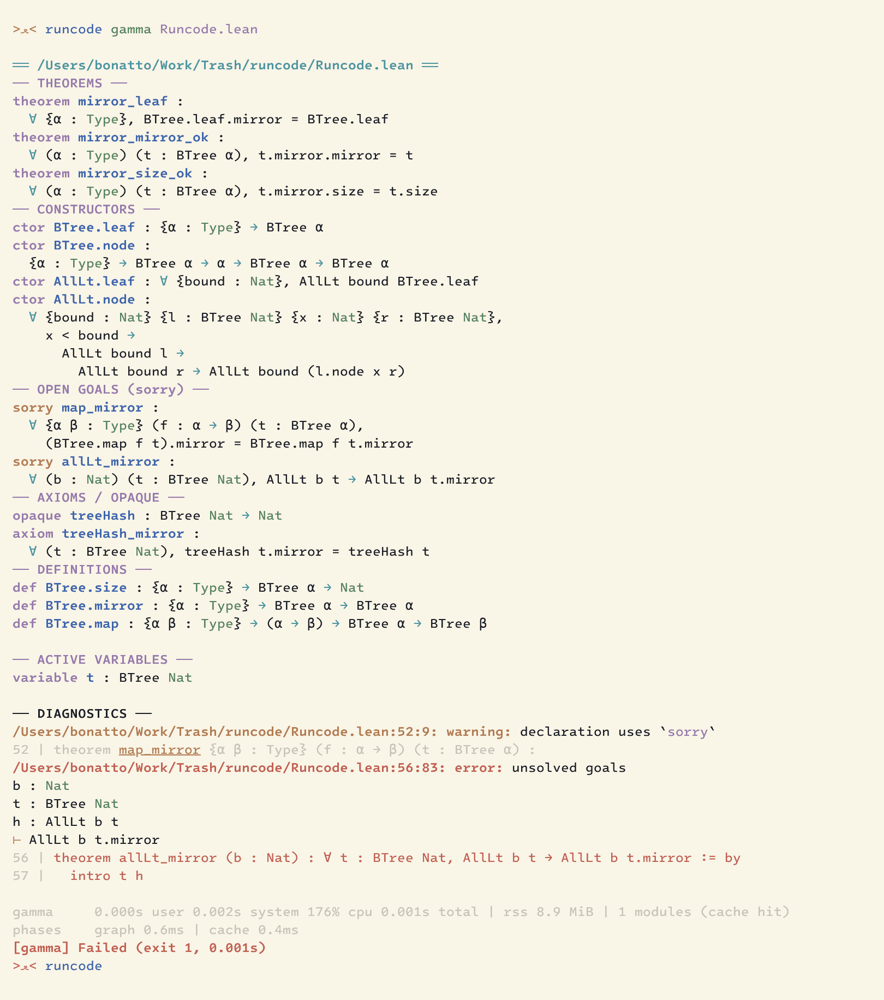

# gamma

Fast Lean 4.36.0 project checker and context inspector for macOS Apple Silicon (`aarch64-apple-darwin`).

`gamma` embeds the Lean 4 elaboration runtime via a C-ABI shared library (`LeanChecker`) so project discovery, dependency graph construction, content hashing, caching, and terminal rendering happen in Rust while parsing, elaboration, environment inspection, and diagnostics run directly inside Lean without spawning child `lean` or `lake` processes at runtime.



## Architecture

| Layer | Component | Responsibility |
| --- | --- | --- |
| Rust | `src/project/` | Locates project root (`lakefile.toml` / `lakefile.lean`), assembles `LEAN_PATH`, and scans Lean import headers (`prelude`, `module`, `public import`) while skipping `--` and nested `/- ... -/` comments. |
| Rust | `src/graph/` | Builds the reachable local import DAG, detects import cycles, produces a topological module order, and computes a parallel BLAKE3 content fingerprint (`rayon` + `blake3`). |
| Rust | `src/cache/` | Stores and retrieves inspection JSON in `.gamma/cache.json` keyed by graph fingerprint. |
| Rust | `src/backend/` | Thread-safe FFI wrapper around `gamma_inspect_json` / `gamma_free`. |
| Rust | `src/output.rs` | Buffered ANSI renderer providing Lean 4 syntax highlighting, underlined diagnostic source spans, phase timings, and `getrusage(RUSAGE_SELF)` resource reporting. |
| C11 | `c/gamma_shim.c` | Thread-safe one-time Lean runtime initialization (`pthread_once`) and C-string marshaling over the Lean 4 FFI. |
| Lean 4 | `lean/LeanChecker/` | Elaborates the target file (`Language.Lean.process`), unfolds `Prop` definitions, extracts active `variable`s, classifies declarations, and serializes `InspectOutput` as JSON. |

## Output and Diagnostics

`gamma` prints declarations in topological module order followed by the target file, grouped into:

- `THEOREMS` — proved `theorem`s with `Prop` definitions unfolded
- `CONSTRUCTORS` — inductive constructors (`ctor`)
- `OPEN GOALS (sorry)` — theorems containing `sorry` or unsolved tactic goals
- `AXIOMS / OPAQUE` — `axiom` and `opaque` declarations
- `DEFINITIONS` — non-`Prop` definitions (excluding internal/auxiliary declarations)
- `ACTIVE VARIABLES` — elaborated section `variable`s in scope
- `DIAGNOSTICS` — `error`, `warning`, and `info` messages with underlined source snippets

Each run concludes with process telemetry (`user`, `system`, CPU %, wall time, peak RSS via `getrusage(RUSAGE_SELF)`), cache hit/miss status, per-phase timings (`graph`, `lean` or `cache`), and a final status line:

- Exit `0`: `[gamma] Passed` (no errors; warnings and `sorry` allowed)
- Exit `1`: `[gamma] Failed` (Lean elaboration errors or unsolved goals)
- Exit `2`: CLI usage error, missing file, import cycle, or FFI failure

## Implementation Boundaries

- **Compile-time Lake invocation only**: `build.rs` invokes `lake build LeanChecker:shared` and compiles `c/gamma_shim.c` during `cargo build`. At runtime, `gamma` calls the Lean backend in-process via the C ABI.
- **Dynamic linking**: The macOS build links `lib*LeanChecker.dylib` and `libleanshared.dylib` dynamically using recorded `-Wl,-rpath` entries. A relocatable `.app`/tarball distribution requires copying those dylibs and Lean's stdlib tree and rewriting install names.
- **Prebuilt `.olean` consumption**: `gamma` checks the target file against existing `.olean` artifacts on `LEAN_PATH`; it does not compile dirty local dependencies into `.olean` files.
- **Internal FFI surface**: Lean's C/module initialization ABI is internal to `leanprover/lean4:v4.36.0`.

## Requirements

- macOS on Apple Silicon (`aarch64-apple-darwin`)
- Rust toolchain (`cargo`, `rustc` 2021 edition) and C compiler (`cc`)
- Lean toolchain pinned to `leanprover/lean4:v4.36.0` (e.g., via `elan`)
- `lake` available in `PATH` (or via `LAKE`) at build time

## Build

```sh
cargo build --release --target aarch64-apple-darwin
```

Optional build-time environment overrides:

- `LEAN_SYSROOT` — path to the Lean `v4.36.0` toolchain sysroot (defaults to `lake env lean --print-prefix`)
- `LAKE` — path to the `lake` executable (defaults to `lake`)

## Usage

```sh
./target/aarch64-apple-darwin/release/gamma path/to/File.lean
```

At runtime, `LEAN_PATH` is populated from:

1. `<project_root>/.lake/build/lib/lean` and `<project_root>/.lake/build/lib`
2. `.lake/packages/*/.lake/build/lib/lean`
3. Existing `LEAN_PATH` environment entries
4. `<GAMMA_SYSROOT>/lib/lean` (captured at build time)

## Cache

Inspection results are persisted atomically to `<project_root>/.gamma/cache.json` (format version `2`). Cache keys are BLAKE3 hashes (`gamma-cache-v3`) over:

- Pinned toolchain identifier (`leanprover/lean4:v4.36.0`)
- Reachable local module names and exact file bytes (content-addressed, independent of filesystem `mtime`)
- Resolved `LEAN_PATH` search directories

Delete `.gamma/` to force a cold inspection.

## Roadmap / Known Next Steps

1. Validate and benchmark the native `aarch64-apple-darwin` build against `leanprover/lean4:v4.36.0` and resolve any FFI symbol/ABI drift.
2. Bundle `lib*LeanChecker.dylib`, `libleanshared.dylib`, and Lean's core `.olean` tree into a relocatable macOS distribution.
3. Add an optional parallel `.olean` build stage (topological wave compilation) for stale local dependencies.
4. Parse `lakefile.toml` / `lakefile.lean` directly for custom `srcDir` and package dependency roots.
5. Add end-to-end integration tests covering Mathlib projects, import cycles, missing `.olean` files, `sorry`, parser errors, and `unsolved goals`.
